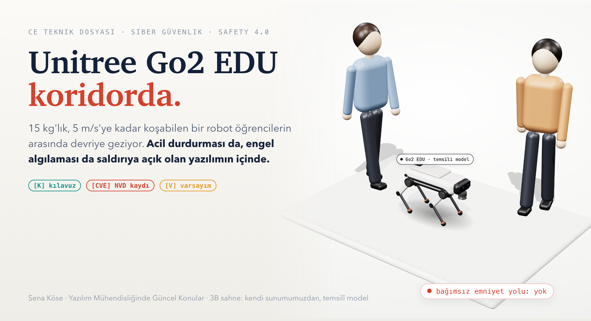
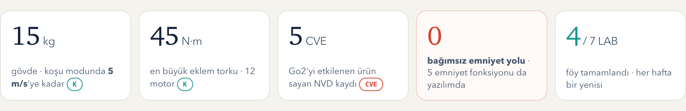
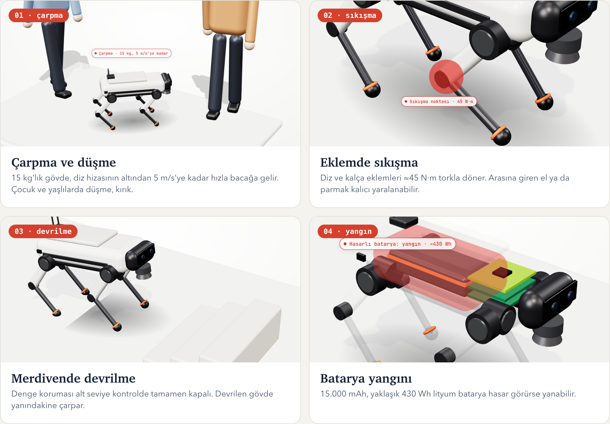
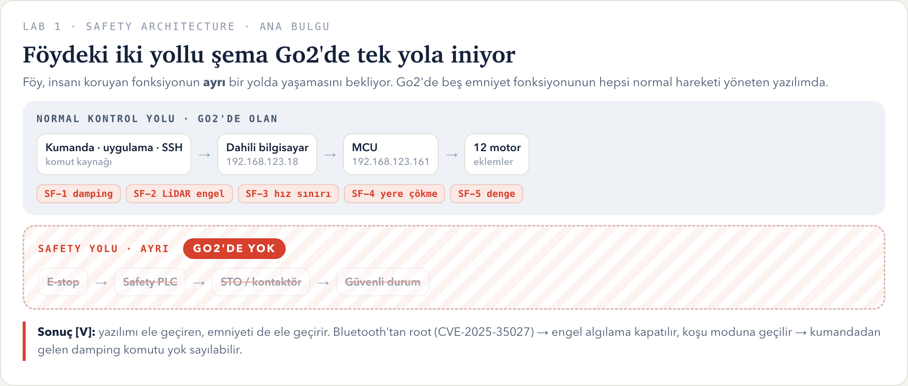
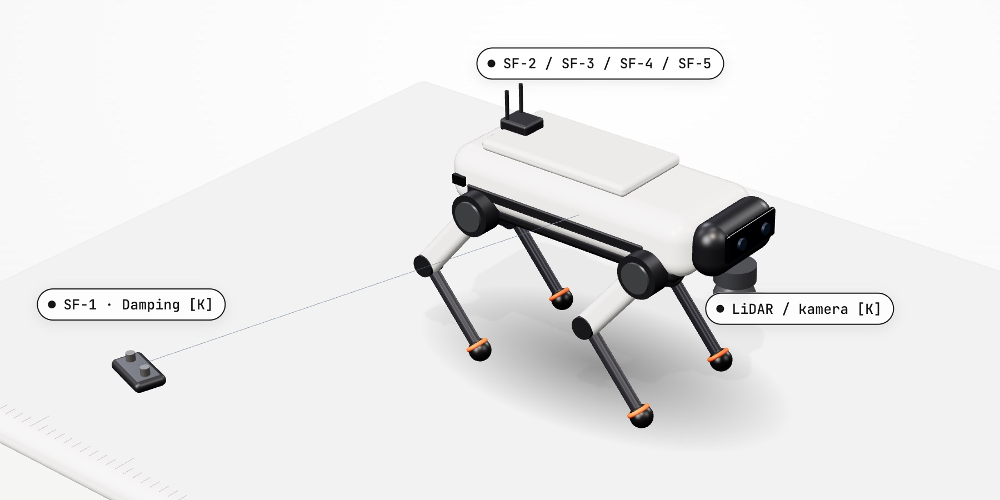
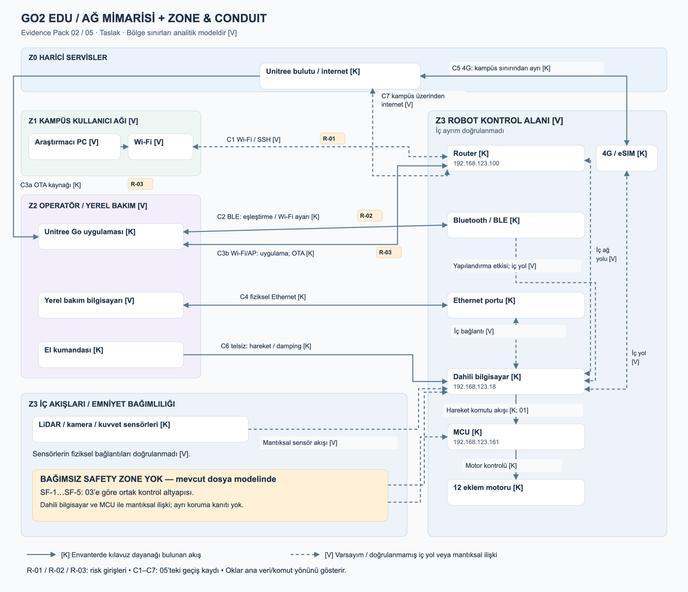
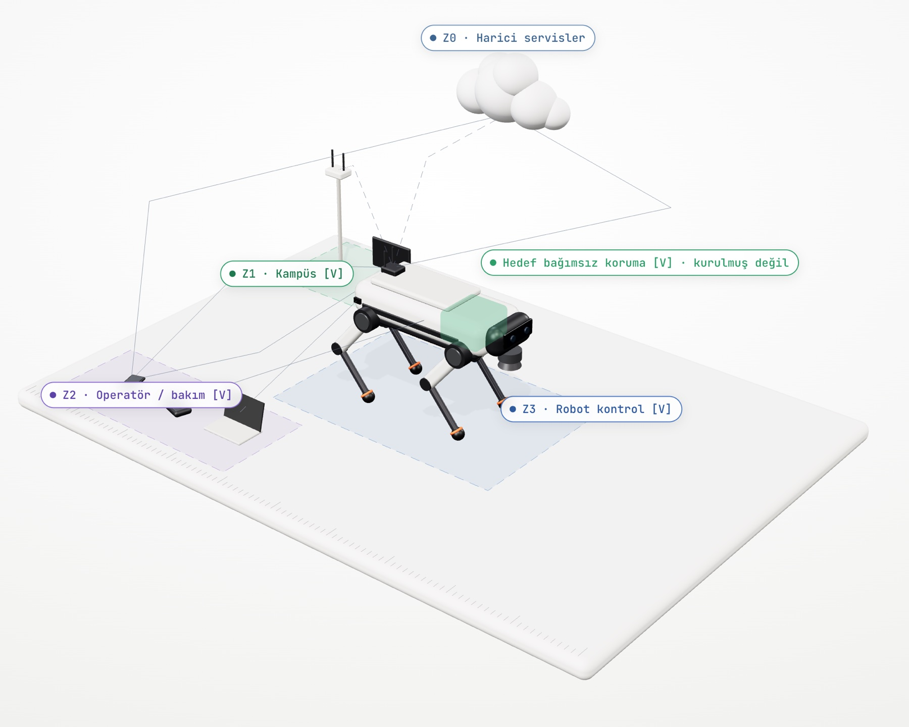
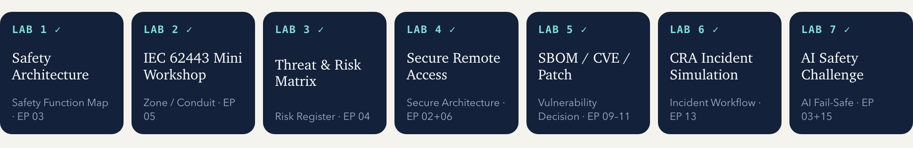

  

<h1 align="center">Unitree Go2 EDU — CE ve Siber Güvenlik İncelemesi</h1>

<b>Siber bir açığın, koridordaki birinin bacağına nasıl çarptığını gösteren akademik bir CE teknik dosyası.</b>

  <b><a href="https://go2-ce-dosyasi.vercel.app">Canlı 3B sunum</a></b> ·
  <b><a href="docs/Unitree_Go2_Laboratuvar_Foyu.pdf">LAB 1–7 föyü (PDF)</a></b> ·
  <a href="docs/Unitree_Go2_Laboratuvar_Foyu_PaketPro.pdf">PaketPro şablonuyla föy</a> ·
  <a href="analizler/SWOT_Analizi.md">SWOT</a> ·
  <a href="analizler/SMART_Analizi.md">SMART</a> ·
  <a href="kaynaklar/Kaynaklar.md">Kaynaklar</a>

  Yazılım Mühendisliğinde Güncel Konular · Sena Köse (235542006) · B Şubesi · Ekim–Kasım 2026

---

Öğle arası, mühendislik fakültesinin koridoru. Ders yeni bitmiş, öğrenciler sınıflardan çıkıyor. Aralarında diz hizasının altında,
on beş kiloluk dört bacaklı bir robot devriye geziyor: Unitree Go2 EDU. Kamerasıyla görüntü aktarıyor, LiDAR'ıyla önüne çıkanı
görüp duruyor. Robotun kumandası laboratuvar sorumlusunun elinde.

Koridorun öbür ucunda, Bluetooth menzili içinde biri telefonunu çıkarıyor. Robotun Wi-Fi ayarını yapan Bluetooth yolunda kayıtlı
bir açık var ([CVE-2025-35027](https://nvd.nist.gov/vuln/detail/CVE-2025-35027)). Root yetkisi alan biri engel algılamayı kapatabilir
ve robotu saniyede beş metreye çıkan koşu moduna alabilir. Laboratuvar sorumlusu kumandadan acil durdurmaya bastığında o komut da
**aynı ele geçirilmiş yazılımdan** geçiyor.

Bu sahne bir varsayım: robot üzerinde denenmedi, kurulu firmware sürümü bilinmiyor. Ama zincirin her halkası ya kullanım
kılavuzunda ya da NVD kaydında yazıyor. Bu repo o zinciri halka halka ayırıyor.

Fark şurada: Bir web sitesi ele geçirildiğinde veri gider, geri yüklenir. Bu robot ele geçirildiğinde koridordaki birinin bacağına
on beş kilo çarpar ve onu geri almanın yolu yoktur. Makine Tüzüğü (AB) 2023/1230, **20 Ocak 2027'den itibaren** siber güvenliği
CE işaretinin ön şartı yapıyor; bu proje de bunun nedenini tek bir robot üzerinden gösteriyor.

  

**Bilgi etiketleri.** Bu repodaki her iddia üç etiketten birini taşır: **[K]** Go2 kullanım kılavuzundan doğrulandı ·
**[CVE]** NVD kaydından doğrulandı · **[V]** benim varsayımım. Çıkarım ile kanıtı karıştırmamak, bu çalışmanın ana kuralı.

---

## İnsan neyden zarar görür?

LAB 1'in ilk sorusu bu. Go2 için cevabın dört parçası var. Görsellerin hepsi [canlı sunumdaki](https://go2-ce-dosyasi.vercel.app) kendi hazırladığımız 3B modelden; robot temsilî bir model, gerçek ölçüleri kılavuzdan [K].

  

## Ana bulgu: emniyet, saldırıya açık yazılımın içinde

Föydeki model şunu söylüyor: insanı koruyan fonksiyon **ayrı** bir yolda yaşar. Acil durdurma düğmesi bir Safety PLC'ye, o da
motorların enerjisini kesen bir kontaktöre gider. Normal kontrol yazılımı çökse ya da ele geçirilse bile bu yol çalışır.

Go2'de bu ikinci yol yok. Kılavuzdaki beş emniyet fonksiyonunun beşi de normal hareketi yöneten dahili bilgisayar ve MCU
yazılımının içinde çalışıyor [K]. Kılavuzun kendisi bile kullanıcıya "bir acil durdurma mekanizması kurun" diyor.

  

  

İki ayrıntı bu bulguyu daha da keskinleştiriyor:

- **Engel algılama (SF-2) kumandada Y tuşuna üç saniye basılınca kapanıyor** [K]. Yani bu fonksiyonun kapatılabilmesi zaten tasarımın bir parçası. Soru, onu kimin kapatabildiği.
- **Güvenli durum her an güvenli değil.** Robot koşarken motorları aniden serbest bırakmak (damping) onu yuvarlayıp devirebilir [V]. Klasik makinede "enerjiyi kes" doğru cevaptır; dört bacaklı bir robotta önce yavaşlamak gerekir.

Ayrıntılı cevaplar: [LAB 1 föyü, PDF sayfa 2](docs/Unitree_Go2_Laboratuvar_Foyu.pdf).

## Ağ: dört bölge, yedi geçit

LAB 2, IEC 62443'ün mantığını uyguluyor: Benzer kritiklikteki cihazları bir bölgeye (zone) topla, bölgeler arasındaki her geçişe
kontrollü bir kapı (conduit) koy. "Bir robot, bir uygulama" gibi görünen sistem, envanter çıkarılınca **13 donanım varlığı,
6 dış bağlantı ve en az 5 hesap/anahtar** çıkarıyor.

  

Şemadaki en rahatsız edici çizgi **C5**: Robotun kendi 4G/eSIM modülü var ve internete kampüs güvenlik duvarının hiç görmediği bir
yoldan çıkabiliyor [K]. Kampüs ağına ne kadar kural yazılırsa yazılsın, bu yol o kuralların dışında kalıyor.

## Üç saldırı senaryosu

LAB 3'ün kuralı basit: Bir senaryo "veri çalındı" ile bitiyorsa henüz emniyet bulgusu değildir; bir adım daha gidip hattaki insana
ne olduğunu sormak gerekir. Her senaryo beş halka: **kim → hangi kapı → ne yapar → zincir → fiziksel sonuç**.

  

**Neden R-01 birinci?** R-01 ile R-02 aynı skoru alıyor (12). Ama R-01'in kapısı, kılavuzda herkese açık yazan varsayılan SSH
hesabı. Firmware sürümüne bağlı değil ve kampüs ağındaki herkes ona ulaşabiliyor. Bir saldırganın en çok emek harcamadan gireceği yer orası.

**R-03 neden düşük skora rağmen listede yukarıda?** Güncelleme zincirini bozmanın kamuya açık bir yolu yok, bu yüzden olasılığı düşük
(L=1). Ama sonucu kalıcı el/parmak yaralanması (S=3). Föyün kuralı açık: S=3 ise skor düşük kalsa bile senaryo görünür tutulur.

## Uzak erişim: bugün ve hedef

LAB 4 iki katmanı birbirinden ayırıyor: **erişim güvenliği** girmeyi zorlaştırır, **emniyet bağımsızlığı** girilse bile insanı korur. İkisi de şart; biri diğerinin yerine geçmiyor.

  

  

Sağdaki beş ilke, saldırganın içeri girme olasılığını düşürüyor. Ama Go2'nin asıl sorunu, **girdikten sonra** ne olduğu. Föy bu
yüzden çözüm değil gereksinim yazdırıyor: *Acil durdurma ve güvenli duruş, dahili bilgisayar, ağ veya yazılım ele geçirilse de
çalışmalı; hiçbir uzaktan komut bunu kapatamamalı ya da geciktirememeli.* Bunu nasıl yapacağına karar vermek üreticinin işi.

---

## Föyler

  

| Dosya | İçerik |
| --- | --- |
| [`docs/Unitree_Go2_Laboratuvar_Foyu.pdf`](docs/Unitree_Go2_Laboratuvar_Foyu.pdf) | **Ana föy.** Genel Sürüm (şişeleme hattı) şablonu, kapak + LAB 1–7, Go2'ye göre doldurulmuş, 8 sayfa. LAB 5–7 sayfalarının altında şablondaki örneğin Go2 karşılığını gösteren bir "Go2 uyarlaması" kutusu var. |
| [`docs/Unitree_Go2_Laboratuvar_Foyu_PaketPro.pdf`](docs/Unitree_Go2_Laboratuvar_Foyu_PaketPro.pdf) | **Ek föy.** Aynı LAB 1–7, PaketPro 3000 (paketleme makinesi) şablonunun sorularıyla. PaketPro'ya özgü iki soru Go2 karşılığıyla cevaplandı: "uzak bakım modülü" → 4G/eSIM + bulut, "ışık perdesi zinciri" → LiDAR engel algılama + kumanda acil durdurma; LAB 6'daki "egzoz" → Go2'de yok, yerine emniyet zinciri; LAB 7'deki "görsel paket kontrolü" → YZ'li insan/engel algılama. |
| [`analizler/SWOT_Analizi.md`](analizler/SWOT_Analizi.md) | Projenin ve makinenin güçlü/zayıf yönleri, fırsatlar, tehditler ve çıkan strateji. |
| [`analizler/SMART_Analizi.md`](analizler/SMART_Analizi.md) | 18 Aralık'a kadar ölçülebilir hedefler, iş paketleri ve izleme tablosu. |
| [`kaynaklar/Kaynaklar.md`](kaynaklar/Kaynaklar.md) | Üretici, satış, kılavuz ve CVE kaynakları; her birinin doğrulama durumu. |
| [`PROJE_KAPSAMI.md`](PROJE_KAPSAMI.md) | Kullanım senaryosu, veri sınıflandırması, Evidence Pack'in 15 başlığı ve durumu. |
| [`HAFTALIK_ILERLEME.md`](HAFTALIK_ILERLEME.md) | Hangi LAB'ın bittiği ve güncelleme kuralı. |

## Güvenlik açıkları

NVD'de Go2'yi etkilenen ürünler arasında sayan beş kayıt var (16.10.2026'da kontrol edildi). Hepsi aynı ortak firmware'den
geliyor; Go2'nin yanında G1, H1 ve B2 robotları da etkileniyor.

| CVE | Konu | CVSS 3.1 | Hangi senaryo |
|---|---|---:|---|
| [CVE-2025-35027](https://nvd.nist.gov/vuln/detail/CVE-2025-35027) | Bluetooth ile Wi-Fi ayarı sırasında komut enjeksiyonu → root | 7.3 | R-02 |
| [CVE-2025-60017](https://nvd.nist.gov/vuln/detail/CVE-2025-60017) | Wi-Fi SSID/parola alanından root komut enjeksiyonu | 8.2 | — |
| [CVE-2025-60251](https://nvd.nist.gov/vuln/detail/CVE-2025-60251) | Bluetooth el sıkışmasında zayıf parola kontrolü | 5.0 | — |
| [CVE-2025-60250](https://nvd.nist.gov/vuln/detail/CVE-2025-60250) | Bluetooth paketlerinde herkesçe bilinen sabit anahtar | 4.7 | — |
| [CVE-2026-1442](https://nvd.nist.gov/vuln/detail/CVE-2026-1442) | Firmware güncellemelerinin değiştirilebilmesi | 7.8 | R-03 |

CVE-2025-35027 kaydına göre Go2 firmware **1.1.8 ve öncesi** etkileniyor. İncelediğimiz robotun sürümü bilinmediği için karar
ihtiyatlı: *sürüm doğrulanana kadar etkilenmiş kabul edilir.* Unitree açığı kabul etti; düzeltilmiş sürümü doğrulayan resmî bir
kaynak bulamadım. [LAB 5'te](docs/Unitree_Go2_Laboratuvar_Foyu.pdf) (PDF sayfa 6) bu karar "bileşen var mı / sürüm etkileniyor mu / açık ulaşılabilir mi" diye üç adımda verildi: dört Bluetooth/Wi-Fi kaydı **etkilenmiş kabul**, CVE-2026-1442 yerel erişim istediği için **koşullu**.

## Makine

|  |  |
|---|---|
| **Üretici / model** | Unitree Robotics — Go2 EDU (aile: Air, Pro, X, EDU) |
| **Tür** | Dört bacaklı (quadruped) mobil robot |
| **Resmî ürün sayfası ve gerçek fotoğraflar** | [unitree.com/go2](https://www.unitree.com/go2) |
| **Satış sayfası** | [shop.unitree.com/products/unitree-go2](https://shop.unitree.com/products/unitree-go2). 23.10.2026'da mağazada Air, Pro ve X listeleniyordu; **EDU mağazada yok**, satış ekibi veya yetkili distribütör üzerinden satılıyor. |
| **Kullanım kılavuzu** | [GO2 User Manual](https://www.docs.mybotshop.de/downloads/GO2_User_Manual.pdf) (Almanya distribütörü MYBOTSHOP) |
| **Kılavuzdan doğrulanan [K]** | ≈15 kg gövde, 12 eklem motoru, MCU 192.168.123.161, dahili bilgisayar 192.168.123.18, router 192.168.123.100, 4D LiDAR L1, HD kamera, 15.000 mAh batarya, el kumandası, Bluetooth 5.2, Wi-Fi 6, 4G/eSIM, Ethernet ve USB portları |
| **Bilinmeyen** | Seri numarası, kurulu firmware sürümü, takılı opsiyonlar (ör. Jetson Orin), gerçek ağ yapılandırması, üreticinin AB uygunluk beyanı (internette bulunamadı) |

Gerçek robot fotoğrafları Unitree'ye ait olduğu için bu repoya kopyalanmadı; yukarıdaki resmî sayfadan görülebilir. Repodaki bütün
görseller ya kendi 3B sunumumuzdan ya da kendi çizdiğimiz şemalardan.

## Ne iddia etmiyoruz

- **Bu bir CE belgesi değil.** Gerçek bir uygunluk beyanı, belgelendirme ya da "robot güvenli" garantisi yok. Akademik bir teknik dosya taslağı.
- **Robotta hiçbir şey denenmedi.** Fiziksel robota erişim yok; tarama, istismar veya ayar değişikliği yapılmadı. Saldırı zincirlerindeki emniyet etkileri [V] çıkarımdır.
- **CVE'lerin bu robotu etkilediği kanıtlanmadı.** Etkilenme kurulu firmware sürümüne bağlı ve o sürüm bilinmiyor.
- **Hedef mimari kurulmuş değil.** Jump server, VPN, MFA, kişisel hesap ve bağımsız emniyet önerilerin hepsi [V]; risk puanları bu öneriler yüzünden düşürülmedi.
- **Kılavuzdaki her bilgi her Go2'ye uymayabilir.** Port 9000'deki web sunucusu gibi bazı parçalar distribütörün eklediği modüller.
- **Saldırı ayrıntısı yok.** Bluetooth anahtarı, parola ya da istismar adımı bu repoya yazılmadı; yalnızca etki ve önlem anlatılıyor.

## Kanıt dizini

| İddia | Nerede | Nasıl kontrol edilir |
|---|---|---|
| Beş emniyet fonksiyonu da normal kontrol yazılımında | [Kılavuz](https://www.docs.mybotshop.de/downloads/GO2_User_Manual.pdf): kumanda tuş tablosu ve "Emergency Response" bölümü | Acil durdurma bir kumanda komutu (Damping Mode: L2 uzun + B); ayrı bir Safety PLC tarif edilmiyor ve kullanıcıya "install an emergency stop mechanism" deniyor |
| Engel algılama kumandadan kapatılabiliyor | Kılavuz, kumanda tuş tablosu | "Obstacle Avoidance OFF — Y (Long Press for 3s)" |
| `unitree` SSH hesabı ve varsayılan parolası herkese açık | Kılavuz, robota SSH ile bağlanma adımı | Parola kılavuzda yazıyor; bu repoya kopyalanmadı |
| Go2'yi etkileyen 5 CVE | NVD bağlantıları yukarıda | Her kaydın "affected products" bölümü |
| Go2 ≤ 1.1.8 etkileniyor | [CVE-2025-35027](https://nvd.nist.gov/vuln/detail/CVE-2025-35027) | Kaydın açıklama metni |
| CVE-2026-1442 yerel erişim ister | [CVE-2026-1442](https://nvd.nist.gov/vuln/detail/CVE-2026-1442) | CVSS vektörü `AV:L/UI:R` |
| Risk puanları | [LAB 3, PDF sayfa 4](docs/Unitree_Go2_Laboratuvar_Foyu.pdf) | L × S × E çarpımı ve S=3 kuralı |
| CVE etkilenme kararı | [LAB 5, PDF sayfa 6](docs/Unitree_Go2_Laboratuvar_Foyu.pdf) | Her kayıt için var / sürüm / ulaşılabilir üçlüsü |
| CRA bildirimi üreticinin yükümlülüğü | [LAB 6, PDF sayfa 7](docs/Unitree_Go2_Laboratuvar_Foyu.pdf) | Tüzük (AB) 2024/2847, raporlama yükümlülükleri 11.09.2026'dan itibaren |
| EDU sürümü mağazada yok | [Satış sayfası](https://shop.unitree.com/products/unitree-go2) | Sayfadaki sürüm seçenekleri (23.10.2026) |

## Haftalık güncelleme

Ders her hafta bir LAB işliyor; bu repo da onunla büyüyor.

1. Tamamlanan LAB sayfası **iki PDF'nin de sonuna** eklenir. Daha önce teslim edilen sayfaların içeriği değiştirilmez (yalnızca kapaktaki sayfa listesi ve sayfa numaraları güncellenir).
2. README'deki ilerleme görseli, [`HAFTALIK_ILERLEME.md`](HAFTALIK_ILERLEME.md) ve SWOT/SMART yeni bulgulara göre güncellenir.
3. Her LAB ayrı bir commit olur: `docs: LAB 5 eklendi (30.10.2026)`.

**Durum (06.11.2026):** Yedi LAB'ın hepsi iki şablonda da tamamlandı. LAB 5 beş CVE için "bizi etkiliyor mu?" kararını, LAB 6 Go2'ye uyarlanmış CRA olay akışını (24 s / 72 s / 14 gün), LAB 7 YZ'li algılama için fail-safe kararlarını içeriyor. Sırada Evidence Pack'in kalan başlıkları (EP 10–15) var.

---

  Sena Köse · Fırat Üniversitesi Yazılım Mühendisliği · Yazılım Mühendisliğinde Güncel Konular, Güz 2026 
  Föy şablonları: Safety 4.0 Bootcamp (Inspecco × Kriptarium). 3B sahneler ve şemalar: kendi çalışmamız.

